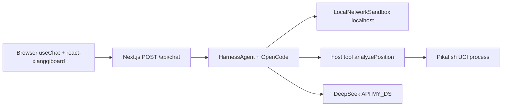

# 象棋分析智能体：开发规范与实现计划

## 现状

[vp-projects/demos/pikafish-agent](vp-projects/demos/pikafish-agent) 目前只有 [AGENTS.md](vp-projects/demos/pikafish-agent/AGENTS.md) 和 [pikafish-engine](vp-projects/demos/pikafish-agent/pikafish-engine) 下的说明/协议文本，**没有引擎二进制、没有 Next.js 应用**。父仓是 Vite+ pnpm monorepo（`demos/*` 已纳入 workspace），但本 demo 按 AGENTS.md **使用 Next.js，不走 `vp pack`**。

已确认选择：Harness 用 OpenCode；sandbox **本地、不依赖 Vercel/云账号**。皮卡鱼在 Next.js 宿主机以 **host tool** 跑（Windows 通用二进制），不放进 Linux 容器。

## 产品范围（MVP）

象棋**分析**智能体，不是完整对弈平台。

- 左侧棋盘：摆子 / 导入 FEN / 展示当前局面
- 右侧对话：用中文问「这步好不好」「怎么走」「评估」
- 智能体必须先调皮卡鱼，再解释；**禁止在没有引擎结果时编造着法或评分**
- 引擎 PV 以箭头叠加到棋盘
- 人机对弈放到后续迭代，不进 MVP

## 开发规范（执行时写入仓库）

规范分两层，避免 AGENTS.md 膨胀（见 writing-for-agents：步骤在顶层，分支参考放到指针后面）。

### 1. 重写 [AGENTS.md](vp-projects/demos/pikafish-agent/AGENTS.md)

只保留 agent 每次都要遵守的内容：

- **定位**：皮卡鱼驱动的象棋分析智能体；FEN 是局面唯一事实来源。
- **栈**：Next.js App Router 服务端；`@ai-sdk/harness` + `@ai-sdk/harness-opencode`；`@ai-sdk/react` 的 `useChat`；模型 DeepSeek `deepseek-v4-flash`（API 仍接受此 id，实际路由到当前 Flash）；`apiKey` 只读 `MY_DS`。
- **棋盘 UI**：`react-xiangqiboard`（React 原生、MIT、支持 FEN 与箭头；分析场景比 canvas 方案更合适）。
- **Seam**：
  - `PikafishEngine`：小接口，藏 UCI 进程/握手/`info` 解析
  - `createLocalNetworkSandboxSession`：返回 `HarnessV1NetworkSandboxSession`，交给 `HarnessAgent.createSession({ sandboxSession })`。本机 workspace、端口、进程留在实现内。
  - `HarnessAgent`：会话、skill、host tool 的唯一入口
- **不变量**：着法与评分只来自皮卡鱼；OpenCode 只负责任务编排与解释；host tool 在 Node 进程执行，不经过 sandbox；二进制与 `.nnue` 放在 `pikafish-engine/` 并随仓库提供。
- **指针**：`docs/architecture.md`（何时改栈/会话）、`docs/uci.md`（何时改引擎协议）、`package.json`（命令以环境为准，不在 AGENTS 里复述）。

### 2. 新增 `docs/architecture.md` 与 `docs/uci.md`

- 架构：请求如何从 `useChat` 进 `HarnessAgent.stream`，session 如何 `detach`/`resume`
- UCI：`uci` → `position fen` → `go movetime` → 解析 `info`/`bestmove`；局面必须带历史着法时用 `position fen ... moves ...`，不能只发最后一张 FEN
- 皮卡鱼 Wiki：https://www.pikafish.com/wiki/reference/engine-runtime.html

## 架构



关键运行时约定：

- OpenCode 是 **bridge-backed harness**，必须有能暴露端口的 network sandbox。官方 `@ai-sdk/sandbox-vercel` 不用。本仓库用 `createLocalNetworkSandboxSession` 得到 `HarnessV1NetworkSandboxSession`，再交给 `HarnessAgent.createSession({ sandboxSession })`。会话目录 + 本机 `exec`/`spawn` + `getPortEndpoint` 返回 `127.0.0.1:<port>`。这不是 VM 隔离，而是满足 Harness V1 的本地 adapter；接口按安装后的 `@ai-sdk/harness` 类型核对，不凭记忆写。
- DeepSeek 经 OpenCode 的 OpenAI-compatible 通道：`OPENAI_API_KEY=MY_DS`，`OPENAI_BASE_URL=https://api.deepseek.com`，`provider: 'openai'`，model `deepseek-v4-flash`。
- 皮卡鱼 **host tool**：`analyzePosition({ fen, moves?, movetimeMs })` 在 Next.js 进程 spawn 引擎。OpenCode 的 `bash`/`write` 默认收紧（`inactiveTools` 或 `permissionMode`），避免编码 agent 改仓库。
- 会话：`chat id` = harness `sessionId`；`session.detach()` 持久化到本机文件（demo 足够），路由按 [Harness UI](https://ai-sdk.dev/docs/ai-sdk-harnesses/ui) 用 `toUIMessageStream`，不要直接 `createAgentUIStreamResponse`。

## 目录与模块

在 [vp-projects/demos/pikafish-agent](vp-projects/demos/pikafish-agent) 内建 Next.js App Router 应用（保留现有 `AGENTS.md` 与 `pikafish-engine/`）：

- `src/app/page.tsx` — 棋盘 + 聊天
- `src/app/api/chat/route.ts` — Harness 流式路由
- `src/lib/agent.ts` — `HarnessAgent` 工厂（module scope）
- `src/lib/session-store.ts` — resume / detach
- `src/lib/sandbox/local-network-sandbox.ts` — Harness V1 本地 sandbox
- `src/lib/pikafish/engine.ts` — UCI 引擎 deep module
- `src/lib/tools/analyze-position.ts` — host tool
- `src/components/XiangqiBoard.tsx` — `react-xiangqiboard` 封装（FEN + PV 箭头）
- `pikafish-engine/` — 各平台通用二进制与 `pikafish.nnue`，随仓库提供
- `.env.example` — `MY_DS=`
- `skills/xiangqi-analysis.md` — Harness skill：如何读评分、如何向棋手解释、何时再搜

`PikafishEngine` 对外只要：

```ts
analyze(input: { fen: string; moves?: string[]; movetimeMs?: number; depth?: number }): Promise<{
  bestMove: string
  score: { type: 'cp' | 'mate'; value: number }
  pv: string[]
  wdl?: { win: number; draw: number; loss: number }
  depth: number
}>
```

进程握手、`stop`、串行化搜索、NNUE 路径全部藏在实现里。

## 工程约束（Vite+ monorepo + Next.js）

- package name：`pikafish-agent`；scripts 用 `next dev` / `next build` / `next start`，外加 `vp test` 测纯 TS 模块（引擎解析、sandbox 契约）
- 根目录 Vite+ 的 `prefer-vite-plus-imports` 不要套到 Next.js 文件；本包用自己的 lint/tsconfig
- `.gitignore` 忽略 `.env*.local`；`pikafish-engine/` 里的通用二进制、`.nnue` 与协议 txt 一并入库
- 实现 AI SDK 时对照 **已安装版本** 的 `node_modules/ai/docs` 与 `@ai-sdk/harness` 类型，不凭记忆写 `useChat` / Harness API

## 实现顺序

1. **脚手架**：在现有目录初始化 Next.js（App Router + TS + Tailwind），写入 `.env.example`，引擎路径探测 Windows `Pikafish-Windows-x86-64-universal.exe` / Linux `Pikafish-Linux-x86-64-universal`。
2. **引擎模块 + 测试**：UCI 解析与 `analyze()`；无二进制时集成测试 skip，有二进制时跑一次开局 `movetime 200`。
3. **LocalNetworkSandbox**：对照 Harness V1 类型实现 create/resume、文件、exec、端口；最小测试覆盖 `getPortEndpoint` 与工作目录。
4. **HarnessAgent**：OpenCode + DeepSeek 认证 + `analyzePosition` host tool + xiangqi skill；`/api/chat` 按官方 UI 路由做 session。
5. **前端**：`useChat` + `react-xiangqiboard`；把 tool 输出的 FEN/PV 画到棋盘；渲染 `text` / `reasoning` / `tool-analyzePosition`。
6. **规范落地**：更新 AGENTS.md（写上选定的棋盘组件）、补 `docs/*`、浏览器走通「分析当前开局」。

## 验收

- `MY_DS` 已配置时，本地 `pnpm dev` 可打开页面（引擎在 `pikafish-engine/`）
- 用户问开局评估：出现皮卡鱼 tool 结果（bestmove / cp 或 mate / pv），助手中文解释与之一致，棋盘出现 PV 箭头
- 无 `MY_DS` 或无引擎时，错误信息可读，而不是泛 HTTP 500
- `vp test`（本包）覆盖 UCI 解析；`pikafish-engine/` 中的通用二进制与 NNUE 随仓库提供
