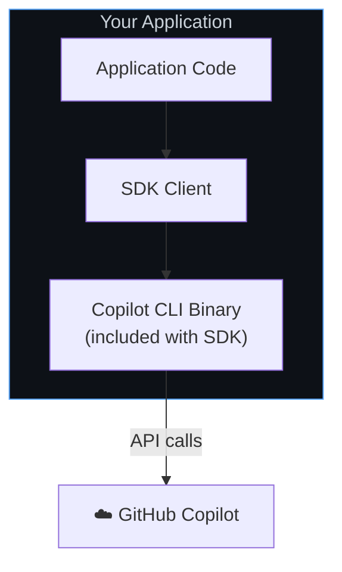

# 微软用Rust重写GitHub Copilot：

https://mp.weixin.qq.com/s/eFk6THFSCbbucjdnwW5QAQ

https://github.blog/ai-and-ml/generative-ai/migrating-the-github-copilot-runtime-to-rust-using-copilot/

Copilot 代理运行时支持了：包括 GitHub Copilot CLI 和 GitHub Copilot 应用，还包括 VS Code、Visual Studio、CCA、Copilot 代码评审（CCR）、Copilot 协作、Copilot 工作室，以及 Excel、Outlook、PowerPoint、Word 等等，还有更多

最初始设计：服务于CLI, 是一个终端用户界面（TUI），建立在代理循环之上。碰巧的是，整个堆栈都是用 TypeScript 实现的，使用 Node.js 作为框架，V8 作为执行引擎，以及 Ink 和 React 用于 UI

弊端： 在其它语言客户端， 必须打包nodejs 或 v8 ，且独立进程，需要对事件，消息进行来回推送。

重构：

- 不包括 TUI
- 依赖项最少且开销最小的语言实现
- 具有高性能、可扩展性和可靠性的语言实现
- 适合互操作的语言实现 FFI 机制

重构方法： 原子替换，空中换引擎。

仓库地址：https://github.com/github/copilot-sdk
pnpm install @github/copilot-sdk



```
Your Application
       ↓
  SDK Client
       ↓ JSON-RPC
  Copilot CLI (server mode)
```
