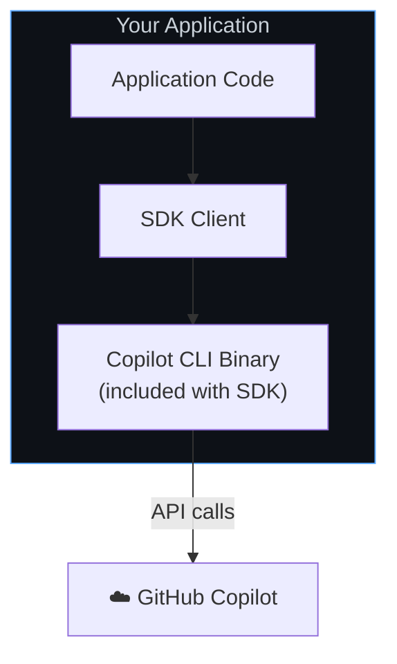

# 微软用Rust重写GitHub Copilot：

## 我的分析

https://mp.weixin.qq.com/s/eFk6THFSCbbucjdnwW5QAQ

https://github.blog/ai-and-ml/generative-ai/migrating-the-github-copilot-runtime-to-rust-using-copilot/

Copilot 代理运行时支持了：包括 GitHub Copilot CLI 和 GitHub Copilot 应用，还包括 VS Code、Visual Studio、CCA、Copilot 代码评审（CCR）、Copilot 协作、Copilot 工作室，以及 Excel、Outlook、PowerPoint、Word 等等，还有更多

最初始设计：服务于CLI, 是一个终端用户界面（TUI），建立在代理循环之上。碰巧的是，整个堆栈都是用 TypeScript 实现的，使用 Node.js 作为框架，V8 作为执行引擎，以及 Ink 和 React 用于 UI

弊端： 在其它语言客户端， 必须打包nodejs 或 v8 ，且独立进程，需要对事件，消息进行来回推送。

重构：

- 不包括 TUI
- 依赖项最少且开销最小的语言实现
- 具有高性能、可扩展性和可靠性的语言实现
- 适合互操作的语言实现 FFI 机制

重构方法： 原子替换，空中换引擎。

仓库地址：https://github.com/github/copilot-sdk
pnpm install @github/copilot-sdk

使用示例： demos/rust-copilot-sdk copilot-agent是闭源的， 无法得到rust 的开发源码



```
Your Application
       ↓
  SDK Client
       ↓ JSON-RPC
  Copilot CLI (server mode)
```

经过追查， copilot-cli 没有开源， 也就相当于rust重写的 agent 并没有开源。

安装"@github/copilot-sdk"后，在window上会自动安装 "@github/copilot-sdk-win32-x64"， 它里面的 prebuilds/win32-x64 中有 .exe 和 runtime.node等文件， 估计是rust 生成的napi-rs:

## 官方博客中的互操作性原理

在这个移植中涉及互操作性，有两个主要层次：

临时内部互操作。 每当一个函数被移植到 Rust 时，该函数都需要可被调用，无论 TypeScript 是如何调用初始 TypeScript 函数的。同样，我们也需要让 Rust 函数能够调用 TypeScript 回调。这种互操作需求是一个实现细节，并且非常灵活。随着 Rust 内部接口的扩展，所需的 TypeScript 桥接层的数量也随之增加，因为它们与 TypeScript 需要调用的 Rust 方法是一对一的。当这些调用者被移植到 Rust 时，现有的桥接层会被删除，并替换为新的层。最终，我们达到运行时库的公共入口点，桥接层会消失。
SDK 接口。 所有 SDK 库都需要能够建立在运行时之上并展示其功能。在移植之前，这是通过使用双向 JSON-RPC 层暴露运行时来完成的，SDK 将函数调用请求作为 JSON-RPC 方法调用有效载荷发送，运行时解析请求并调用相关 API，然后通过相同的传输方式将结果返回给 SDK 进行解析和返回。反向方向也存在；运行时需要能够回调 SDK 客户端，例如用于钩子通知和权限请求，这些在 SDK 客户端中表现为使用任何被认为是惯用语言特性的回调（例如 C#中的委托）。
`我们通过 napi-rs 项目的 napi Rust crate 实现了` (1)，该项目旨在用 Rust 构建 Node.js 原生插件。您只需用 #[napi] 注解函数，napi-rs 宏就会生成 N-API 注册粘合代码，使该函数可从 JavaScript 调用，并在生成的 index.d.ts 中为其提供 TypeScript 声明。同步 Rust 函数会变成普通 JavaScript 函数，async fn 会变成返回 Promise 的 JavaScript 函数，而标注了 #[napi(object)] 的结构体会变成另一端的普通对象。

........

第二个互操作性层，即 SDK 接口，是这两个层中的永久层。Copilot SDK 支持 六种语言：TypeScript、Python、Go、C#、Java 和 Rust。它们都使用相同的双向 JSON-RPC 合约，最初它们都通过相同的方式达到这个合约：以无头模式将 Copilot CLI 作为子进程启动，并通过管道或套接字与其通信。在移植过程中，这种方式仍然是默认的。这也意味着任何语言的 SDK 消费者都需要打包或定位完整的 Node 实现，每个事件和每条消息都要支付一个进程跳转，并且需要管理两个进程而不是一个。

将运行时移植到 Rust 才使得另一个选项成为可能。`发布的 runtime.node 是一个普通的平台共享库` （.node 扩展是 Node.js 原生扩展的惯例；其下是一个 .dll 、.so 或 .dylib），现在它为同一个引擎提供了两个前端入口。有一个 napi 入口，Node 进程将其加载为原生扩展；这是 CLI 的路径（今天……在未来，意图是它将完全通过 SDK 路径实现）。还有一个 C ABI 入口，任何语言都可以将其加载到自己的进程中并通过 FFI 调用。通过每种语言的本地互操作机制选择相同的进程内运行时：

## AI 总结分析的 SDK 以及CLI闭源的证据

# copilot-sdk 项目结构与职责分析

> 分析对象：`C:\Users\shen\Desktop\search-copilot-sdk`
> 分析时间：2026-10-12
> 本地仓库：`copilot-sdk`（git remote = `git@github.com:github/copilot-sdk.git`，HEAD = `6be623b0 Update SDK snapshot for Copilot CLI 1.0.96-2`）
> 参照产物：`install-copilot-sdk/node_modules/@github/copilot-sdk@1.0.18` 与 `@github/copilot-sdk-win32-x64@1.0.18`（真实发布包，用于反查运行时来源）

---

## 一、结论速览（先回答四个问题）

| 问题                                   | 结论                                                                                                                                                                                                                                                                                                                                                                                                       |
| -------------------------------------- | ---------------------------------------------------------------------------------------------------------------------------------------------------------------------------------------------------------------------------------------------------------------------------------------------------------------------------------------------------------------------------------------------------------- |
| copilot-sdk 是什么                     | GitHub 官方 **多语言 SDK monorepo**（Node/TS、Python、Go、Rust、Java、.NET 六套），本身**不含** agent 引擎                                                                                                                                                                                                                                                                                                 |
| 目录作用                               | 六个语言子目录 = 六套对等客户端；`scripts/codegen` = 从 JSON Schema 生成六语言协议代码；`test/harness` + `test/snapshots` = 录制回放式 E2E；`docs/` = 跨语言文档                                                                                                                                                                                                                                           |
| 有没有 github-copilot-cli 源码         | **没有**。仓库里只有协议 Schema 投影、JSON-RPC 客户端、运行时**二进制**的下载/加载逻辑。CLI/agent 引擎以预编译产物分发：`prebuilds/<platform>/copilot-runtime(.exe)` + `runtime.node`（win32-x64 上分别为 765 KB 与 114 MB）                                                                                                                                                                               |
| CLI 源码在哪                           | 私有仓库 **`github/copilot-agent-runtime`**（npm 包 `repository` 字段直接指向它，SDK 位于其 `src/sdk`；协议 Schema 由其 `src/native/sdk-contract` 生成）。公开的 `github/copilot-cli` 仓库只有安装脚本 + 文档 + issue 模板，官方在 Discussion #1667 明确「The binaries source is not currently published」，Issue #3241（2026-09-18）仍在请求开源                                                          |
| SDK 是不是只是「下发 JSON-RPC 的入口」 | **方向正确，但表述要修正**。agent 决策逻辑（规划、工具循环、提示词、上下文压缩、沙箱、持久化）100% 在 runtime 里；但 SDK 不是单向瘦客户端——协议是**双向**的，runtime 会反向调用 SDK 进程里的 40 个回调（自定义工具、hooks、权限、elicitation、sessionFs、canvas、skillProvider、providerToken、BYOK 的 llmInference 出口、遥测）。SDK = 传输层 + 客户端能力宿主 + 强类型协议投影 + 运行时打包/生命周期管理 |

---

## 二、仓库目录结构总览

### 2.1 顶层

```
search-copilot-sdk/
├── copilot-sdk/              # 官方 SDK monorepo（github/copilot-sdk 的 clone）
└── install-copilot-sdk/      # 你自己的 pnpm 安装现场，用来观察已发布产物
```

### 2.2 `copilot-sdk/` 根目录

| 路径                                             | 作用                                                                                                                                                                                                                                                                                                                                                       |
| ------------------------------------------------ | ---------------------------------------------------------------------------------------------------------------------------------------------------------------------------------------------------------------------------------------------------------------------------------------------------------------------------------------------------------- |
| `nodejs/`                                        | TypeScript SDK（`@github/copilot-sdk`）。`src/client.ts` 156 KB、`src/session.ts` 113 KB、`src/types.ts` 138 KB                                                                                                                                                                                                                                            |
| `python/`                                        | Python SDK（`github-copilot-sdk`）。`copilot/client.py` 233 KB、`session.py` 146 KB、`generated/rpc.py` **3.2 MB**                                                                                                                                                                                                                                         |
| `go/`                                            | Go SDK。`rpc/zrpc.go` **1.8 MB**、`internal/jsonrpc2`（自研帧编解码）、`internal/ffihost`（C ABI 绑定）、`internal/embeddedcli`（CLI 下载缓存）、`cmd/bundler`（把 CLI 打进你的二进制）                                                                                                                                                                    |
| `rust/`                                          | Rust SDK（crates.io `github-copilot-sdk`）。`src/lib.rs` 137 KB、`session.rs` 174 KB、`types.rs` 269 KB、`ffi.rs`、`embeddedcli.rs`；`build/out_of_process.rs` 与 `build/in_process.rs` 在 **build.rs 阶段**从 GitHub Releases 拉运行时                                                                                                                    |
| `java/`                                          | Java SDK。`sdk/src/main/java/com/github/copilot/{rpc,tool,ffi}`；`copilot-native/` 是空壳 Maven 模块，只负责按平台 classifier 抓取 native 运行时（JNA 路线）                                                                                                                                                                                               |
| `dotnet/`                                        | .NET SDK（NuGet `GitHub.Copilot.SDK`）。`src/Generated/Rpc.cs` **2.9 MB**、`src/Polyfills/`（.NET 8 目标的语言特性补齐）、`src/build/GitHub.Copilot.SDK.targets`（MSBuild 期解析运行时包）                                                                                                                                                                 |
| `docs/`                                          | 跨语言文档：`setup/`（bundled-cli、local-cli、backend-services、in-process-runtime、multi-tenancy、scaling）、`features/`（agent-loop、hooks、mcp、skills、custom-agents、streaming-events、fleet-mode、cloud-sessions…）、`hooks/`、`auth/`、`observability/`、`troubleshooting/compatibility.md`（SDK vs CLI 能力矩阵）                                  |
| `scripts/`                                       | monorepo 编排：`run-tasks.mjs`（`npm run build:test:lint:format:generate:<lang>`）、**`codegen/`（typescript/python/go/rust/csharp 五个生成器 + extensible-enums + legacy-parameters）**、`runtime-layout.mjs`（判断是否嵌套在 runtime 仓库内）、`ci/`（运行时产物准备与隔离）、`corrections/`、`docs-validation/`                                         |
| `test/`                                          | `harness/`：`replayingCapiProxy.ts`（92 KB，拦截 runtime 发往模型厂商的 HTTP 流量并按快照回放，含 OpenAI Responses / Chat Completions / Anthropic Messages 三套适配器）、`capturingHttpProxy.ts`、一批 `test-mcp-*.mjs` 测试用 MCP 服务；`snapshots/`：**507 个**快照文件（YAML 会话录像）                                                                 |
| `samples/runtime-host/`                          | 运行时宿主的候选源解析 / 暂存 / 冒烟脚本                                                                                                                                                                                                                                                                                                                   |
| `assets/`                                        | README 头图                                                                                                                                                                                                                                                                                                                                                |
| `.github/`                                       | 每语言一条流水线（`sdk-nodejs.yml`、`sdk-python.yml`、`sdk-go.yml`、`sdk-rust.yml`、`sdk-java.yml`、`sdk-dotnet.yml`）+ `sdk.yml`（Schema/生成新鲜度）+ `sdk-runtime-artifact.yml`；`actions/download-sdk-runtime`（带三次重试的产物下载）、`setup-copilot`、`run-alpine-tests`；`agents/`、`skills/`、`commands/`（给 Copilot coding agent 用的仓库配置） |
| `BUILD.bazel`                                    | 嵌套进 runtime 仓库时的 Bazel 目标（standalone 检出用不到）                                                                                                                                                                                                                                                                                                |
| `sdk-protocol-version.json`                      | `{"version": 3}` —— SDK/runtime 协议大版本，六语言各有对应常量                                                                                                                                                                                                                                                                                             |
| `AGENTS.md` / `CONTRIBUTING.md` / `CHANGELOG.md` | 贡献者与 AI agent 指南；明确区分「runtime 仓库布局」与「standalone SDK 仓库布局」                                                                                                                                                                                                                                                                          |

### 2.3 每个语言 SDK 的内部分层（以 Node 为例，其他语言一一对应）

| 文件                                                                                                                    | 职责                                                                                                                                                                |
| ----------------------------------------------------------------------------------------------------------------------- | ------------------------------------------------------------------------------------------------------------------------------------------------------------------- |
| `nodejs/src/client.ts`                                                                                                  | 客户端总入口：解析连接方式、拉起/杀死运行时进程、TCP/stdio/in-process 三种传输、鉴权与环境变量注入、全局 RPC（models/mcp/plugins/skills/agents/account…）、AHP host |
| `nodejs/src/session.ts`                                                                                                 | 会话对象：send/sendAndWait、事件订阅与分发、hooks 派发、权限与 elicitation 回环、自定义工具执行、canvas、workflow、structured output                                |
| `nodejs/src/host.ts`                                                                                                    | `AhpHost`（runtime-supervised host，实验特性）：由 runtime 托管的监听器/会话目录                                                                                    |
| `nodejs/src/ffiRuntimeHost.ts`                                                                                          | 用 **koffi** 绑定 `runtime.node` 的固定 C ABI，实现进程内托管                                                                                                       |
| `nodejs/src/runtimeArtifacts.ts`                                                                                        | 运行时二进制的解析、校验（非空 + 存在）、指纹化缓存、平台判定（含 musl 检测）                                                                                       |
| `nodejs/src/cliVersion.ts`                                                                                              | 生成出来的版本钉子：`COPILOT_CLI_VERSION = "1.0.96-2"`、`COPILOT_CLI_USE_NPM_PACKAGE = false`                                                                       |
| `nodejs/src/copilotRequestHandler.ts`                                                                                   | 通用「runtime → 应用」请求处理器骨架（32 KB）                                                                                                                       |
| `nodejs/src/sessionFsProvider.ts`                                                                                       | 应用侧虚拟文件系统 provider（远端/多租户场景把会话文件读写代理到你的存储，含 sqlite 通道）                                                                          |
| `nodejs/src/canvas.ts` / `workflow.ts` / `toolSet.ts` / `telemetry.ts` / `extension.ts` / `installationConfirmation.ts` | Canvas UI、workflow 引擎宿主、`availableTools` 过滤器构建器、OTel、扩展桥、安装确认                                                                                 |
| `nodejs/src/generated/rpc.ts`、`generated/session-events.ts`                                                            | **自动生成，禁止手改**：从 `api.schema.json` / `session-events.schema.json` 投影出的全部协议类型                                                                    |

---

## 三、有没有 github-copilot-cli 的源码？——没有，且能给出完整证据链

### 3.1 本地仓库里没有

- 全仓库检索不到任何内置工具（`bash` / `grep` / `apply_patch` / `str_replace_editor`）的**实现**，只有它们的名字与 Schema 描述（例如 `nodejs/src/generated/rpc.ts:28882` 的注释 `Tool identifier (e.g., "bash", "grep", "str_replace_editor")`）。
- 没有提示词模板、没有 LLM HTTP 客户端、没有上下文压缩/规划逻辑、没有沙箱实现。SDK 里唯一的「出网 HTTP」是两件与 agent 无关的事：下载 CLI release（`python/copilot/_cli_download.py`、`go/cmd/bundler/main.go:43`、`rust/build/out_of_process.rs:81`）和 BYOK 的 `llmInference.*` **反向**桥（由应用替 runtime 发请求）。
- `docs/features/agent-loop.md` 自己就写死了这条边界：「The **SDK** is a transport layer… The **CLI** is the orchestrator that runs the agentic tool-use loop」，并在表格里注明 SDK「Passes events through; does not control the loop」。

### 3.2 引擎是以「预编译二进制」形式发下来的

`install-copilot-sdk/node_modules/@github/copilot-sdk-win32-x64@1.0.18/` 实测内容：

```
prebuilds/win32-x64/
  copilot-runtime.exe        765,888 B   # 瘦宿主：加载 runtime.node，把 stdio 桥到 C ABI
  runtime.node           114,260,416 B   # 真正的 agent 引擎（Rust + N-API）
  dpapi.node / msal-node-runtime.node / msalruntime.dll   # Windows 凭据 & Entra 认证
definitions/*.agent.yaml        # 内置 agent 定义：code-review / explore / research / security-review / task / rubber-duck / rem-agent
definitions/sidekick/*.yaml     # 后台 sidekick agent 定义
builtin-skills/                 # customize-cloud-agent / discover-resources / github-pr-media
plugins/computer-use/*.exe      # computer-use 插件（含 MCP server 可执行文件）
ripgrep/bin/win32-x64/rg.exe    # 内置 rg
tgrep/bin/win32-x64/tgrep.exe
schemas/api.schema.json (2.28 MB) + session-events.schema.json (975 KB)
preloads/extension_*.mjs, animations/*.json.gz
```

对 `runtime.node` 做字符串探测（`findstr`）：

| 特征串                       | 命中 | 含义                |
| ---------------------------- | ---- | ------------------- |
| `/rustc/`                    | 是   | Rust 编译产物路径   |
| `cargo`                      | 是   | Rust 构建痕迹       |
| `napi_register_module_v1`    | 是   | Node-API 模块入口   |
| `copilot_runtime_host_start` | 是   | 导出给 SDK 的 C ABI |

对 `copilot-runtime.exe` 探测：命中 `runtime.node` 与 `copilot_runtime_host_start` → 它就是个加载器。

**结论：agent 引擎是一个 Rust 写的 N-API 原生库，SDK 只是它的宿主。** 这与 GitHub 官方博客一致：Copilot agent runtime 已迁移到 Rust，约 80 万行生产 Rust 代码，统一支撑 Copilot CLI、Copilot SDK、IDE 扩展、Copilot app 与 M365 Copilot。

### 3.3 二进制从哪来

- Python：`python/copilot/_cli_version.py:get_download_url()` → `https://github.com/github/copilot-cli/releases/download/v{version}/github-copilot-{version}-{platform}.tgz`，配 `SHA256SUMS.txt` 校验；不稳定版走 `github/copilot-sdk` 仓库的 `runtime-{version}` tag。
- Node：`nodejs/scripts/set-cli-version.js:34`、`nodejs/scripts/unified-release.ts:310` 同一 URL 规则；`nodejs/src/runtimeArtifacts.ts` 负责平台判定（8 个目标：darwin/linux/linuxmusl/win32 × x64/arm64）、指纹缓存到 `%LOCALAPPDATA%\github-copilot-sdk\runtime`（macOS `~/Library/Caches/...`，Linux `~/.cache/...`）。
- Rust：`rust/build/out_of_process.rs:81`、`rust/build/in_process.rs:494` 在编译期下载。
- Go：`go/cmd/bundler/main.go:43` 的 `defaultCLIDownloadBaseURL`。
- Java：不打包，`java/copilot-native/scripts/fetch-native.mjs` 按 classifier 抓 native 产物。

### 3.4 源码仓库在哪

三条硬证据指向 **私有仓库 `github/copilot-agent-runtime`**：

1. 发布包的 `package.json`：
   `"repository": { "url": "https://github.com/github/copilot-agent-runtime.git", "directory": "src/sdk" }`
   （`@github/copilot-sdk` 与 `@github/copilot-sdk-win32-x64` 都是这个字段），并带 `"copilotRuntime": { "sourceSha": "fdeb5949...", "version": "1.0.94", "visibility": "public" }`。
2. `CONTRIBUTING.md`：「The **SDK root** is `src/sdk` in `github/copilot-agent-runtime`, or the repository root in the standalone `github/copilot-sdk` checkout」；「In `github/copilot-agent-runtime`, Rust contracts under `src/native/sdk-contract` produce `generated/api.schema.json` and `generated/session-events.schema.json`」；「Author SDK implementation changes in the runtime repository `src/sdk`」。
3. 本地 git 历史清一色是 `Update SDK snapshot for Copilot CLI 1.0.x-y` —— 说明公开仓库是内部 runtime 仓库的**定期快照镜像**，用发布产物做钉子。

而公开的 `github/copilot-cli` 仓库（Copilot CLI 的官方发布渠道）**不含源码**，目录只有 `install.ps1`、`install.sh`、`docs/`、`.github/ISSUE_TEMPLATE/`、`CHANGELOG.md`、`README.md`、`LICENSE.md`。官方答复：

- Discussion #1667（2025-11-07，已锁定）：「The Copilot CLI repo hosts the installation script, documentation, and issue tracking. The binaries source is not currently published.」
- Issue #3241（2026-09-18，仍 open）：「Publish the Copilot CLI source code」。

### 3.5 一个很能说明问题的细节：SDK 运行时 = CLI 运行时 − TUI

`nodejs/src/runtimeArtifacts.ts` 里有一份 `EXCLUDED_TOP_LEVEL` 黑名单，用于从**完整 CLI 包**（内部 canary 路径 `COPILOT_CLI_USE_NPM_PACKAGE=true` 时的 `@github/copilot-<platform>`）裁出 SDK 运行时：

```
app.js, cli-main.js, index.js, npm-loader.js, sea-loader.js,
copilot, copilot.exe,            ← TUI 可执行入口
webview, animations 之外的 voice-*.js, pvrecorder,   ← 语音
foundry-local-sdk, queries, napi-oop-runtime, mediaremote-adapter,
tree-sitter*.wasm, cli-native.node, copilot-runtime-bin*
```

被保留的正是 `prebuilds/<platform>/{copilot-runtime, runtime.node}` + `definitions/`、`builtin-skills/`、`plugins/`、`ripgrep/`、`schemas/`。
**换句话说：SDK 与 CLI 共用同一个 Rust 引擎，SDK 只是把终端 UI、语音、webview 这些交互外壳剥掉了。**

---

## 四、SDK 与运行时的三种连接形态

| 形态                     | 选项（各语言）                                                                                            | 机制                                                                                                               | 证据                                                                                                                                |
| ------------------------ | --------------------------------------------------------------------------------------------------------- | ------------------------------------------------------------------------------------------------------------------ | ----------------------------------------------------------------------------------------------------------------------------------- |
| **stdio 子进程**（默认） | 默认 / `RuntimeConnection.forStdio({path})`                                                               | SDK 拉起 `copilot-runtime --headless --no-auto-update --stdio`，用 `Content-Length` 分帧的 JSON-RPC 走标准输入输出 | `nodejs/src/client.ts:3054`（`const args = [...this.connectionExtraArgs, "--headless", "--no-auto-update"]`）、`:3062`（`--stdio`） |
| **TCP**                  | `RuntimeConnection.forTcp({port})` / `cliUrl`                                                             | 连接本地或远端 headless 运行时，自动带连接令牌                                                                     | `client.ts:3066`（`--port`）、`:3072`（`--auth-token-env COPILOT_SDK_AUTH_TOKEN`）                                                  |
| **进程内 FFI**（实验）   | `forInProcess()` / Go `-tags copilot_inprocess` / Rust `bundled-in-process` / .NET `GHCP001` / Java + JNA | 直接 `dlopen` `runtime.node`，绑定 5 个固定 C ABI 符号，JSON-RPC 帧走内存缓冲                                      | `nodejs/src/ffiRuntimeHost.ts:23`（`SYMBOL_PREFIX = "copilot_runtime_"`）、`go/internal/ffihost/ffihost.go`                         |

进程内模式的完整 C ABI 只有 5 个函数：

```
copilot_runtime_host_start
copilot_runtime_host_shutdown
copilot_runtime_connection_open
copilot_runtime_connection_write
copilot_runtime_connection_close
+ 一个出站回调（runtime → SDK 的帧投递）
```

其他启动参数：`--log-level`、`--no-auto-login`、`--session-idle-timeout`、`--remote`（远程会话 / Mission Control）。

---

## 五、职责划分：CLI(runtime) 做什么，SDK 做什么

### 5.1 运行时（`runtime.node` / `copilot` CLI，闭源）负责

- **agent loop**：一次 `session.send` → 多轮 LLM 调用；每轮 = 一次 API call（`assistant.turn_start` / `turn_end`），模型要求工具就执行工具、把结果喂回下一轮，直到没有工具请求 → `session.idle`。
- **内置工具实现**：bash/shell、文件读写与 patch（`apply_patch`、`str_replace_editor`）、grep/glob（自带 `rg.exe`、`tgrep.exe`）、web fetch、任务/子 agent 派发等。
- **模型层**：模型目录与能力/计费/策略、provider 适配（OpenAI Responses、Chat Completions、Anthropic Messages）、流式增量、重试。
- **上下文管理**：token 预算、自动压缩（compaction）、`infiniteSessions`、system prompt 组装、custom instructions / AGENTS.md 发现。
- **会话持久化**：`~/.copilot/session-state/{sessionId}/events.jsonl` 事件日志、resume、fork、workspace 检查点。
- **认证**：GitHub 设备码登录、keychain/DPAPI/MSAL 凭据、PAT、GitHub App installation token、 Entra/Managed Identity。
- **沙箱与安全**：路径白名单、命令审批策略、sandbox proxy CA、内容排除（content exclusion）、managed settings。
- **扩展生态的服务端**：MCP 客户端（stdio/HTTP/SSE + OAuth）、skills 安装/发现、plugins 与 marketplace、custom agents（`definitions/*.agent.yaml`）、fleet mode、cloud sessions、远程会话、计划任务（schedule）、canvas 渲染引擎、workflow 引擎。

### 5.2 SDK（本仓库，MIT 开源）负责

- **运行时供给**：解析/下载/校验/指纹缓存二进制，或连接外部 server；Go/Rust 还能把 CLI 嵌进你的发布物。
- **进程与连接生命周期**：spawn、优雅停止（EOF → 等待 → kill）、崩溃回收、并发 start 去重、TCP 令牌、in-process 库常驻与线程编组。
- **协议层**：`Content-Length` 分帧 JSON-RPC、请求/响应/通知关联、取消与超时、前向兼容（未知事件/字段不炸）。
- **强类型投影**：从两份 Schema 生成六语言的全部请求/响应/事件类型（Node `generated/rpc.ts`、Python `generated/rpc.py` 3.2 MB、Go `rpc/zrpc.go` 1.8 MB、.NET `Generated/Rpc.cs` 2.9 MB、Rust `types.rs` 269 KB）。协议面实测 **531 个唯一方法名**，按 `server.*` / `session.*` / `clientSession.*` / `clientGlobal.*` 四大段组织。
- **事件路由**：runtime 只用一条 `session.event` 通知推所有事件，SDK 负责解复用成 40+ 种强类型事件、delta 拼接、`sendAndWait` 等待 `session.idle`。
- **客户端能力宿主（关键：这部分逻辑跑在你的进程里）**：实测 **40 个 runtime → SDK 的反向 handler**：

```
session.event / session.lifecycle                      事件与生命周期
hooks.invoke                                           12 种 hook 回调派发（preToolUse/preMcpToolCall/postToolUse/postToolUseFailure/userPromptSubmitted/userPromptTransformed/sessionStart/sessionEnd/errorOccurred/agentStop/subagentStart/subagentStop）
external_tool.requested → session.tools.handlePendingToolCall   自定义工具在应用进程执行
permission.requested    → session.permissions.handlePendingPermissionRequest
userInput.request / autoModeSwitch.request / exitPlanMode.request
canvas.open / canvas.close / canvas.action.invoke
sessionFs.{readFile,writeFile,appendFile,readdir,stat,rename,rm,mkdir,exists,sqlite*}
skillProvider.list / skillProvider.read
providerToken.getToken / gitHubToken.getToken / installations.confirm
llmInference.{httpRequestStart,httpRequestChunk,httpResponseStart,httpResponseChunk}   BYOK 出口
workflow.execute / workflow.abort / tasks.cancel
systemMessage.transform / gitHubTelemetry.event / extensionLaunchProvider.resolve
host.materializeSession / host.sessionReleased / host.exited                           AHP
```

- **工程化周边**：OTel 导出与 trace 上下文传播、遥测、日志、结构化输出（JSON Schema 约束）、多租户/`mode: "empty"`、E2E 回放测试基建。

### 5.3 一次 `session.send()` 的完整链路

```
你的代码
  └─ session.send({prompt})                       [SDK 进程]
       └─ JSON-RPC request "session.send"         ──stdio/TCP/FFI──▶  [runtime]
                                                                        ├─ 组装上下文 + system prompt
                                                                        ├─ 调用 LLM（HTTP，出网）
                                                                        │     └─(BYOK 时) llmInference.httpRequestStart ──▶ SDK ──▶ 你的 provider
                                                                        ├─ 模型要工具？
                                                                        │   ├─ 内置工具：runtime 自己执行（bash/edit/grep…）
                                                                        │   ├─ 需要审批：permission.requested ──▶ SDK 的 onPermissionRequest
                                                                        │   ├─ hooks：hooks.invoke ──▶ SDK 的 onPreToolUse/onPostToolUse…
                                                                        │   └─ 自定义工具：external_tool.requested ──▶ SDK 执行 ──▶ session.tools.handlePendingToolCall
                                                                        ├─ 每个动作都以 session.event 通知回流 ──▶ SDK 解复用 ──▶ 你的 on("...")
                                                                        └─ 无工具请求 → session.idle
       └─ sendAndWait() 在 session.idle 处返回     [SDK 进程]
```

---

## 六、正面回答：「SDK 是不是只是一个入口？」

**是**的部分（你的判断成立）：

- 所有 agent 智能都在闭源 runtime 内。SDK 里没有任何一行提示词、工具实现、上下文管理或模型调用逻辑。
- SDK 对 agent loop **没有控制权**：官方文档原话「SDK passes events through; does not control the loop」，turn 的推进由 runtime + 模型决定。
- 协议面 531 个方法，绝大多数是「SDK 请求 → runtime 执行」，SDK 的角色确实是把语言原生 API 翻译成 JSON-RPC。

**但需要修正**的部分：

1. **它是双向的，不是单向下发。** 40 个反向 handler 意味着相当一部分「行为」实际发生在你的进程里：自定义工具的执行体、hook 的决策、权限批准、`ask_user` 交互、会话文件系统、canvas 渲染回调、skill 内容供给、BYOK 的模型请求出口。runtime 负责「决定何时调用」，SDK/应用负责「真正执行」。
2. **它承担了非平凡的系统职责。** 二进制供给与校验、跨平台缓存、进程/线程生命周期、C ABI FFI、分帧编解码、前向兼容、六语言类型系统（仅生成代码就有数 MB）——这些都是实打实的工程量，不是「一个入口」。
3. **同一引擎，两种外壳。** CLI 与 SDK 的关系不是「CLI 是主程序、SDK 是壳」，而是「同一个 Rust runtime，CLI 套 TUI 外壳，SDK 套语言外壳」。`EXCLUDED_TOP_LEVEL` 黑名单正是这个裁剪过程的直接证据。

一句话总结：

> **copilot-sdk = Copilot agent runtime 的多语言宿主与协议绑定层；github-copilot-cli = 同一个 runtime 的终端宿主。agent 的大脑在闭源的 `github/copilot-agent-runtime` 里，两边都只是在外面接线。**

---

## 七、版本与兼容性约束（实操要注意）

| 项                       | 值                                                                                                                                                                                                                                    |
| ------------------------ | ------------------------------------------------------------------------------------------------------------------------------------------------------------------------------------------------------------------------------------- |
| SDK 协议版本             | `sdk-protocol-version.json` = `3`（六语言各有常量，改一处要 `npm run update:protocol-version` 同步六份）                                                                                                                              |
| 本地 SDK 钉住的 CLI 版本 | `nodejs/src/cliVersion.ts` → `1.0.96-2`                                                                                                                                                                                               |
| 已安装 npm 包            | `@github/copilot-sdk@1.0.18`，`copilotCliVersion = 1.0.94`，`copilotRuntime.sourceSha = fdeb5949...`                                                                                                                                  |
| Schema 来源              | runtime 仓库 `src/native/sdk-contract` → `api.schema.json` / `session-events.schema.json`；standalone 检出则从钉住的 release 下载                                                                                                     |
| 手改禁区                 | 所有 `generated/` 与 `go/z*.go`、`go/rpc/z*.go`、协议版本常量、`test/snapshots/`（改行为要改 YAML，不要删）                                                                                                                           |
| 能力差异                 | `docs/troubleshooting/compatibility.md` 列出 CLI-only 能力：`/login` `/mcp` `/skills` `/plan` `/fleet` `/review` `/usage` `-p/--prompt` `--continue` `--share` 等；SDK 侧权限是 **deny-by-default**，必须显式给 `onPermissionRequest` |

---

## 八、想看 agent 内部逻辑，可行的观测手段（在没有源码的前提下）

1. **事件流**：订阅全部 `session.event`，等于拿到 runtime 的完整执行轨迹（每个 turn、每次工具调用、每个 token 增量）。
2. **磁盘事件日志**：`~/.copilot/session-state/<sessionId>/events.jsonl`（`grep -c "assistant.turn_start"` 即 LLM 调用次数）。
3. **日志**：`logLevel: "debug"` + `cliArgs: ["--log-dir=..."]`；`session.debug.collectLogs`。
4. **OpenTelemetry**：`docs/observability/opentelemetry.md`，可导出 span 看工具耗时与模型调用。
5. **模型层流量**：直接复用本仓库的 `test/harness/replayingCapiProxy.ts` + `capturingHttpProxy.ts` 思路——把 runtime 的出网 HTTP 指向本地代理，即可录到真实请求体（含完整 system prompt 与工具定义）。这是**逆向 agent 行为最有效的入口**。
6. **声明式资产**：运行时包里的 `definitions/*.agent.yaml`、`builtin-skills/`、`plugins/*/plugin.json`、`schemas/*.schema.json` 都是明文，可直接读，能看到内置 agent 的人格、工具集与提示词骨架。
7. **协议 Schema**：`api.schema.json`（2.28 MB）本身就是 runtime 能力的完整目录，带自然语言描述。

---

## 九、附：`install-copilot-sdk/` 的作用

你自己的 pnpm 安装现场（`pnpm@12.10.1`，`allowBuilds: koffi`），依赖只有一个 `@github/copilot-sdk: ^1.0.18`。它把发布链路完整摊开了：

```
@github/copilot-sdk@1.0.18                # 纯 JS/TS 客户端 + 类型
  ├── koffi@3.2.1                         # in-process FFI 绑定用
  ├── vscode-jsonrpc@8.2.1                # JSON-RPC 连接实现
  ├── zod@4.3.6                           # 自定义工具的参数 Schema
  └── optionalDependencies: @github/copilot-sdk-{darwin,linux,linuxmusl,win32}-{x64,arm64}@1.0.18
        └── 命中当前平台的那一个，里面装着 copilot-runtime.exe + runtime.node（≈110 MB）
```

即：**「SDK 逻辑包」与「引擎二进制包」分离发布，按平台 optionalDependencies 选装**——这也是判断「源码不在这里」的最直观证据。
